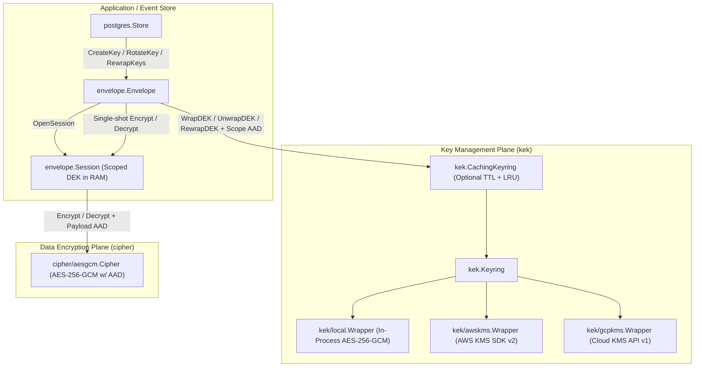

# KMS-Native Envelope Encryption Redesign

## Goal Description

Redesign `github.com/eventsalsa/encryption` into an industry-standard, KMS-native envelope encryption library capable of using **AWS KMS**, **Google Cloud KMS**, or **local symmetric keys** directly as Key Encryption Keys (KEKs) where key material never leaves the KMS boundary.

This redesign eliminates all legacy assumptions that KEKs are raw `[]byte` slices in memory, enforces cryptographic **Additional Authenticated Data (AAD)** binding across both tiers of the key hierarchy to prevent confused-deputy / ciphertext-transplant attacks, solves the KMS latency and rate-limit problem in event-sourced streams via **`envelope.Session`** and **`kek.CachingKeyring`**, isolates cloud SDK dependencies into **Go sub-modules**, and refactors the PostgreSQL schema (`001_encryption_keys.sql`) to enforce strict invariants at the database engine level.

---

## User Review Required

> [!IMPORTANT]
> **Intentional Breaking Changes (Zero Backwards-Compatibility Compromises)**
> Per your direction, this design prioritizes the cleanest possible target architecture without legacy shims:
> 1. **Package Replacement (`systemkey` → `kek`)**: `systemkey` is deleted and replaced by `kek` (core interfaces, multi-provider `Keyring`, and `CachingKeyring`), `kek/local` (in-memory and file-based AES-256-GCM KEK wrapper), `kek/awskms` (sub-module), and `kek/gcpkms` (sub-module).
> 2. **Bytes-First Cryptographic API**: `cipher.Cipher`, `envelope.Envelope`, and `envelope.Session` operate natively on `[]byte` with explicit `aad []byte` parameters (following `crypto/cipher.AEAD` and Google Tink). Ergonomic `EncryptString` / `DecryptString` helpers are provided for base64 string payloads.
> 3. **PostgreSQL Schema Refactoring (`001_encryption_keys.sql`)**:
>    - Renamed `encrypted_key` → `encrypted_dek` and `system_key_id` → `kek_id` (removed the unsafe `DEFAULT 'default'`).
>    - Upgraded `idx_encryption_keys_active` to a **`UNIQUE` partial index** on `(scope, scope_id) WHERE revoked_at IS NULL` so PostgreSQL guarantees at most one active DEK per scope.
>    - Replaced the redundant `idx_encryption_keys_scope` index (which duplicated the primary key) and expanded `idx_encryption_keys_kek_id` to `(kek_id, scope, scope_id, key_version)` to support zero-sort `RewrapKeys` batch scans.
>    - Added `CONSTRAINT revoked_after_created CHECK (revoked_at IS NULL OR revoked_at >= created_at)`.
> 4. **Atomic Store Operations Returning `*encryption.EncryptedKey`**: `store.CreateKey` and `store.RotateKey` now return `(*encryption.EncryptedKey, error)` directly via `RETURNING`, eliminating the extra `SELECT` round-trip previously required after key creation/rotation. `RotateKey` executes revocation + insertion atomically in a single SQL CTE.

---

## Architecture Overview



---

## Proposed Changes

### 1. Root Package (`encryption`)

Consolidate sentinel errors, memory zeroing, and core domain types (`EncryptedKey`, `KeyScope`) in the root package so `envelope` and `postgres` share a unified domain model without circular dependencies.

#### [MODIFY] [errors.go](errors.go)
- Keep existing sentinel errors (`ErrKeyNotFound`, `ErrKeyExists`, `ErrEncryption`, `ErrDecryption`, `ErrInvalidKeySize`, `ErrKeyRevoked`, `ErrKeyDestroyed`) and add `ErrSessionClosed = errors.New("encryption session is closed")` and `ErrInvalidConfig = errors.New("invalid encryption configuration")`.

#### [NEW] [key.go](key.go)
- Define `KeyScope` and `EncryptedKey` in root `encryption` with canonical length-prefixed `AAD()` serialization.

---

### 2. Data Encryption Plane (`cipher` & `cipher/aesgcm`)

Upgrade `cipher.Cipher` to a full AEAD interface supporting Additional Authenticated Data (`aad []byte`).

#### [MODIFY] [cipher/cipher.go](cipher/cipher.go)
#### [MODIFY] [cipher/aesgcm/aesgcm.go](cipher/aesgcm/aesgcm.go)
#### [MODIFY] [cipher/aesgcm/aesgcm_test.go](cipher/aesgcm/aesgcm_test.go)

---

### 3. Key Management Plane (`kek` & `kek/local`)

Delete `systemkey` and introduce `kek` with behavior-based interfaces (`Wrapper`, `Rewrapper`, `Keyring`), a concurrency-safe `CachingKeyring` decorator, and the `kek/local` provider.

#### [DELETE] [systemkey/keyring.go](systemkey/keyring.go)
#### [DELETE] [systemkey/keyring_test.go](systemkey/keyring_test.go)
#### [DELETE] [systemkey/file.go](systemkey/file.go)
#### [DELETE] [systemkey/file_test.go](systemkey/file_test.go)
#### [NEW] [kek/kek.go](kek/kek.go)
#### [NEW] [kek/cache.go](kek/cache.go)
#### [NEW] [kek/local/local.go](kek/local/local.go)
#### [NEW] [kek/kek_test.go](kek/kek_test.go)
#### [NEW] [kek/cache_test.go](kek/cache_test.go)
#### [NEW] [kek/local/local_test.go](kek/local/local_test.go)

---

### 4. Cloud KMS Sub-Modules (`kek/awskms` & `kek/gcpkms`)

Both cloud KMS packages live in their own Go sub-modules so the root module (`github.com/eventsalsa/encryption`) retains zero cloud SDK dependencies.

#### [NEW] [kek/awskms/go.mod](kek/awskms/go.mod)
#### [NEW] [kek/awskms/awskms.go](kek/awskms/awskms.go)
#### [NEW] [kek/awskms/awskms_test.go](kek/awskms/awskms_test.go)
#### [NEW] [kek/gcpkms/go.mod](kek/gcpkms/go.mod)
#### [NEW] [kek/gcpkms/gcpkms.go](kek/gcpkms/gcpkms.go)
#### [NEW] [kek/gcpkms/gcpkms_test.go](kek/gcpkms/gcpkms_test.go)

---

### 5. Envelope Engine & Scoped Sessions (`envelope`)

#### [MODIFY] [envelope/envelope.go](envelope/envelope.go)
#### [NEW] [envelope/session.go](envelope/session.go)
#### [MODIFY] [envelope/envelope_test.go](envelope/envelope_test.go)

---

### 6. PostgreSQL Keystore & Migrations (`postgres` & `postgres/migrations`)

#### [MODIFY] [postgres/migrations/001_encryption_keys.sql](postgres/migrations/001_encryption_keys.sql)
#### [MODIFY] [postgres/store.go](postgres/store.go)
#### [MODIFY] [postgres/rewrap.go](postgres/rewrap.go)
#### [MODIFY] [postgres/rewrap_test.go](postgres/rewrap_test.go)
#### [MODIFY] [postgres/store_integration_test.go](postgres/store_integration_test.go)
#### [MODIFY] [postgres/migrations/generator_test.go](postgres/migrations/generator_test.go)

---

### 7. Test Utilities, Build System, CI & Documentation

#### [MODIFY] [testutil/testutil.go](testutil/testutil.go)
#### [MODIFY] [Makefile](Makefile)
#### [MODIFY] [.github/workflows/ci.yml](.github/workflows/ci.yml)
#### [MODIFY] [.github/workflows/security.yml](.github/workflows/security.yml)
#### [MODIFY] [AGENTS.md](AGENTS.md)
#### [MODIFY] [README.md](README.md)

---

## Verification Plan

### Automated Tests
1. **Unit Tests (Root + Sub-modules with Race Detector)**:
   ```bash
   go test -race -count=1 ./...
   go test -C kek/awskms -race -count=1 ./...
   go test -C kek/gcpkms -race -count=1 ./...
   ```
2. **PostgreSQL Integration Tests (Testcontainers)**:
   ```bash
   go test -race -count=1 -tags=integration ./postgres/...
   ```
3. **Full Validation & Security Suite**:
   ```bash
   make check
   ```
