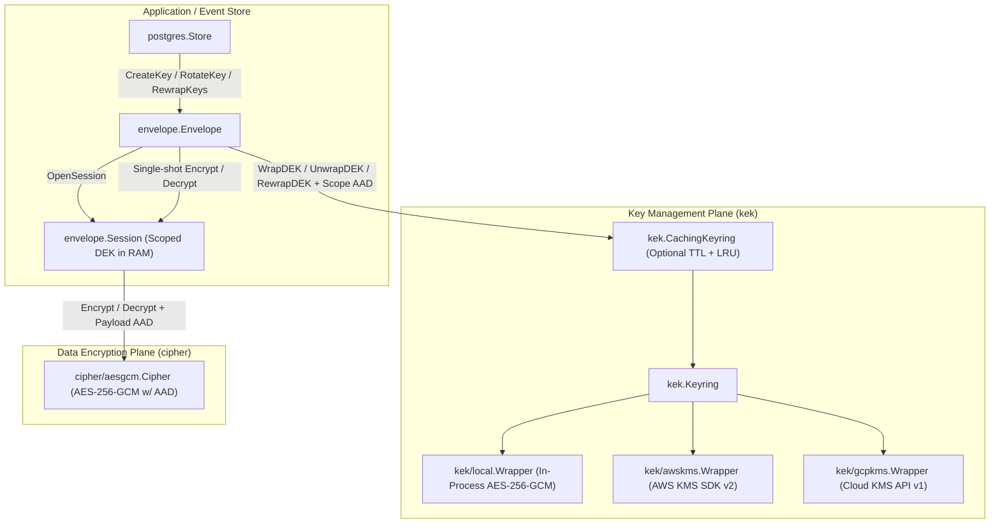

# Walkthrough: KMS-Native Envelope Encryption Redesign

## Overview

This change redesigns `github.com/eventsalsa/encryption` into a KMS-native envelope encryption library capable of using **AWS KMS**, **Google Cloud KMS**, and **local symmetric keys** directly as Key Encryption Keys (KEKs) where key material never leaves the KMS boundary.

---

## Key Changes

### 1. Behavior-Based KEK Plane (`kek` & `kek/local`)
- Replaced `systemkey` with `kek` (`kek.Wrapper`, `kek.Rewrapper`, `kek.Keyring`) so KEKs are represented as cryptographic capabilities (`Wrap`, `Unwrap`, `Rewrap`) rather than raw `[]byte` slices.
- Added `kek.CachingKeyring` ([kek/cache.go](kek/cache.go)), a concurrency-safe bounded TTL + LRU cache decorator that caches defensive copies of unwrapped DEKs in memory and scrubs them via `encryption.ZeroBytes` upon TTL expiration, LRU eviction, `Invalidate()`, or `Close()`.
- Implemented `kek/local` ([kek/local/local.go](kek/local/local.go)) for in-process AES-256-GCM KEK wrapping (`NewWrapper`, `NewKeyringFromMap`, `NewKeyringFromFiles`) with explicit key zeroing on `Close()`.

### 2. Cloud KMS Sub-Modules (`kek/awskms` & `kek/gcpkms`)
- **`kek/awskms`** ([kek/awskms/awskms.go](kek/awskms/awskms.go)): Isolated Go sub-module backed by AWS KMS SDK v2 (`github.com/aws/aws-sdk-go-v2/service/kms`). Implements `kek.Wrapper` and `kek.Rewrapper` (using server-side `kms:ReEncrypt` so plaintext DEKs never enter application memory when rotating between AWS KMS keys) and binds AAD via `EncryptionContext`.
- **`kek/gcpkms`** ([kek/gcpkms/gcpkms.go](kek/gcpkms/gcpkms.go)): Isolated Go sub-module backed by Google Cloud KMS (`cloud.google.com/go/kms`). Implements `kek.Wrapper` with mandatory end-to-end Castagnoli CRC32C integrity verification on both requests and responses (`PlaintextCrc32C`, `CiphertextCrc32C`, `AdditionalAuthenticatedDataCrc32C`).

### 3. Mandatory AAD Binding & Bytes-First AEAD (`encryption`, `cipher`, `envelope`)
- Added `encryption.KeyScope` and `encryption.EncryptedKey` to the root `encryption` package ([key.go](key.go)) with canonical, collision-free length-prefixed AAD serialization (`KeyScope.AAD()`).
- Upgraded `cipher.Cipher` ([cipher/cipher.go](cipher/cipher.go)) and `cipher/aesgcm` ([cipher/aesgcm/aesgcm.go](cipher/aesgcm/aesgcm.go)) to full AEAD (`Encrypt(key, plaintext, aad []byte)` / `Decrypt(key, ciphertext, aad []byte)`).
- Every wrapped DEK is now cryptographically bound to its `(scope, scope_id, key_version)` tuple via AAD, preventing ciphertext-transplant (confused deputy) attacks across database rows.
- Introduced `envelope.Session` ([envelope/session.go](envelope/session.go)) to unwrap a DEK once and perform multiple in-memory AEAD operations (`Encrypt`, `Decrypt`, `EncryptString`, `DecryptString`) with zero network overhead, scrubbing the DEK on `session.Close()`.

### 4. PostgreSQL Schema & Store Refactoring (`postgres` & `postgres/migrations`)
- Refactored [postgres/migrations/001_encryption_keys.sql](postgres/migrations/001_encryption_keys.sql):
  - Renamed `encrypted_key` → `encrypted_dek` and `system_key_id` → `kek_id` (removing the unsafe `DEFAULT 'default'`).
  - Enforced the single-active-key invariant via a `UNIQUE` partial index `idx_encryption_keys_active ON (scope, scope_id) WHERE revoked_at IS NULL`.
  - Replaced the redundant scope index and updated `idx_encryption_keys_kek_id` to `(kek_id, scope, scope_id, key_version)` for zero-sort batch scans during `RewrapKeys`.
  - Added `CONSTRAINT revoked_after_created CHECK (revoked_at IS NULL OR revoked_at >= created_at)`.
- Updated `store.CreateKey` and `store.RotateKey` ([postgres/store.go](postgres/store.go)) to return `(*encryption.EncryptedKey, error)` directly via `RETURNING`, with `RotateKey` executing revocation + insertion atomically in a single SQL CTE.
- Updated `postgres.RewrapKeys` ([postgres/rewrap.go](postgres/rewrap.go)) to delegate DEK rewrapping and AAD verification to `envelope.Envelope`.

---

## Verification Results

- **Formatting & Static Analysis**: `gofmt`, `go vet`, and `golangci-lint` pass with 0 issues across the root module, `kek/awskms`, and `kek/gcpkms`.
- **Unit Tests (with `-race`)**: All unit tests pass across `encryption`, `cipher/aesgcm`, `kek`, `kek/local`, `kek/awskms`, `kek/gcpkms`, `envelope`, `hash`, `postgres`, and `postgres/migrations`.
- **PostgreSQL Integration Tests (Testcontainers)**: All lifecycle, transaction, rotation, concurrency, and batch KEK rewrap tests pass against PostgreSQL 16.
- **Security Scanners**: `gosec` and `govulncheck` pass across all modules with 0 vulnerabilities.
