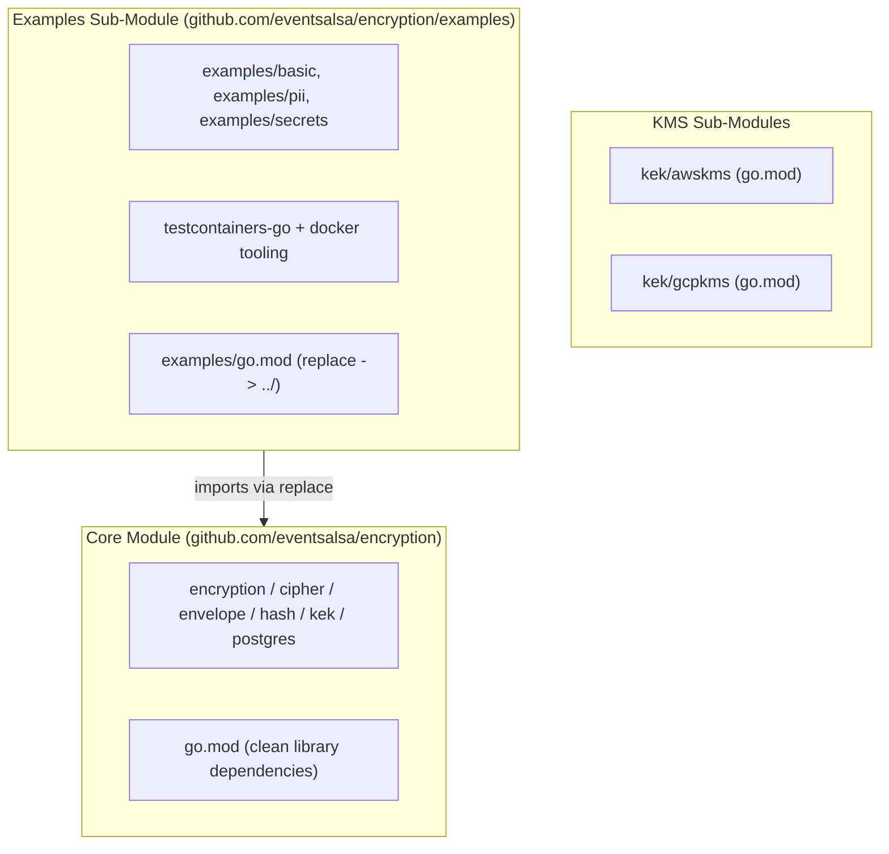

# Walkthrough: Isolate `examples/` Sub-Module and Resolve govulncheck GO-2026-6865

## Overview

The scheduled **Security** CI workflow failed during `govulncheck` due to **[GO-2026-6865](https://pkg.go.dev/vuln/GO-2026-6865)** in `github.com/klauspost/compress`.

Rather than bumping indirect dependencies across the entire core library module, this change **architecturally isolates `examples/` into its own Go sub-module** (`github.com/eventsalsa/encryption/examples`).



### Why This Architecture?
1. **Core Library Isolation**: The core encryption library packages (`cipher`, `envelope`, `kek`, `postgres`, `hash`) never touch container compression paths. Moving `examples/` to its own module ensures example container tooling never contaminates the library's root call graph.
2. **Untouched Root Module**: Root `go.mod` stays strictly focused on library dependencies without forced indirect dependency overrides.
3. **Dedicated Example Lifecycle**: Dependabot and CI now manage example harness dependencies independently in `/examples`.

---

## Changes

### 1. Examples Sub-Module
- Created [`examples/go.mod`](examples/go.mod) and [`examples/go.sum`](examples/go.sum) under `github.com/eventsalsa/encryption/examples` with `replace github.com/eventsalsa/encryption => ../`.
- Bumped `klauspost/compress` to `v1.20.2` in `examples/go.mod` to ensure example runners are clean.
- Reverted root [`go.mod`](go.mod#L35) back to `v1.18.7` demonstrating root independence.

### 2. Build & Tooling Integration
- [`Makefile`](Makefile): Added `examples` to `SUBMODULES`, generalized `golangci-lint` to use `$(CURDIR)/.golangci.yml`, and excluded `examples` directory from the root `gosec` pass.
- [`.github/workflows/ci.yml`](.github/workflows/ci.yml): Added `examples` to `Vet`, `golangci-lint`, and `test` jobs.
- [`.github/workflows/security.yml`](.github/workflows/security.yml): Added `examples` to `gosec`, `govulncheck`, and `CodeQL` analysis.
- [`.github/dependabot.yml`](.github/dependabot.yml): Added `/examples` directory for automated Dependabot updates.

---

## Verification Results

### 1. `govulncheck` Across All 4 Modules
```bash
govulncheck ./...
govulncheck -C kek/awskms ./...
govulncheck -C kek/gcpkms ./...
govulncheck -C examples ./...
```
**Result**: 0 vulnerabilities in application code across all modules.

### 2. Full Validation Suite
```bash
make check
make build
make test
```
- `go vet` (all 4 modules): passed (0 issues)
- `golangci-lint` (all 4 modules): passed (0 issues)
- `go test -race -count=1` (all 4 modules): all passed
- `go test -race -tags=integration ./postgres/...`: passed (with ephemeral Postgres container)
- `gosec` (all 4 modules): passed
- `govulncheck` (all 4 modules): passed
